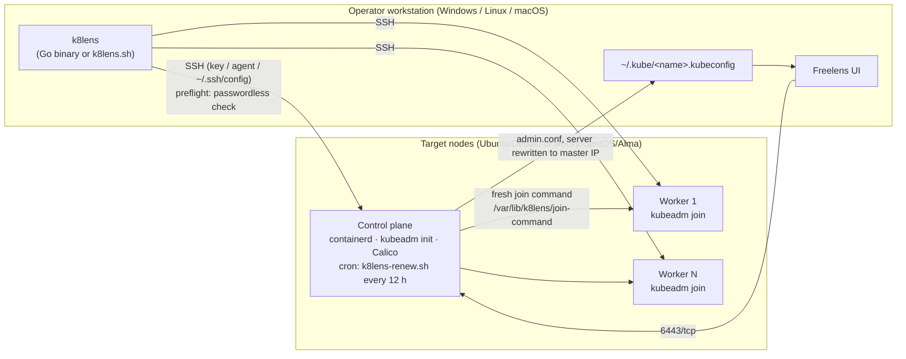

# k8lens

[](https://github.com/GhislainAdon/k8lens/actions/workflows/ci.yml)


[](LICENSE)

> **Idempotent kubeadm bootstrapper.** One command builds a single-node or **1 control-plane + N workers** Kubernetes cluster over SSH (Ubuntu/Debian and Rocky/CentOS/AlmaLinux), then exports a kubeconfig ready for **[Freelens](https://github.com/freelensapp/freelens)**. Ships as a Bash script **and** a native Go binary (Windows/Linux) with a built-in SSH client: no WSL, Git Bash, `ssh.exe` or `scp` needed.

[Résumé en français](#résumé-en-français) · [Documentation complète en français](docs/README.fr.md)

---

## The problem

Standing up a "real" kubeadm cluster on a few VMs or bare-metal boxes (homelab, training, PoC, edge) is a long checklist: containerd with systemd cgroups, swap, kernel modules, sysctl, versioned `pkgs.k8s.io` repos per distro, firewall rules, `kubeadm init`, CNI, join tokens that **expire after 24 h**, and a kubeconfig whose server address works from your laptop. Doing it by hand is error-prone. Re-running half-finished scripts usually breaks things.

`k8lens` automates the whole path and is **safe to re-run**: nodes that already joined are detected and skipped, and `kubeadm init` only runs when no cluster exists.

## Architecture



## Features

- **Single-node or multi-node**: `--single` (control-plane taint removed) or `--master` + repeatable `--worker`
- **Multi-distro, auto-detected** via `/etc/os-release`. You can mix distros in one cluster:
  - Ubuntu/Debian: apt, `pkgs.k8s.io` deb keyring, ufw
  - Rocky/CentOS Stream/AlmaLinux: dnf, EPEL containerd, `pkgs.k8s.io` rpm with `exclude=`, firewalld, SELinux permissive
- **Idempotent**: existing clusters and joined nodes are detected and skipped
- **SSH preflight**: stops early with a clear message if any target asks for a password
- **Join-token renewal cron** (`--install-cron`): regenerates a 24 h worker token and a 2 h control-plane certificate key every 12 h, so a node can join at any time
- **Freelens-ready kubeconfig** exported locally, with the server rewritten to the master IP
- **Optional add-ons** (`--with-addons`): Helm, local-path-provisioner, ingress-nginx
- **Native Go binary**: `golang.org/x/crypto/ssh` client, supports `id_ed25519` / `id_rsa` / `id_ecdsa`, the SSH agent (including the Windows OpenSSH named pipe), `~/.ssh/config` aliases and `known_hosts` *accept-new*

## Quickstart

Prerequisites: key-based SSH from your workstation to every node (`ssh-copy-id user@node`), `sudo` on the nodes (NOPASSWD recommended), Ubuntu 22.04+/Debian 12+ or Rocky/CentOS Stream/AlmaLinux 9+.

```bash
# Build (or download the artifact from the Actions tab)
go build -o k8lens .                        # or ./build-local.sh (Docker, linux + windows)

# Single node
./k8lens --single --master 192.168.1.50

# 1 control plane + 2 workers, pinned Kubernetes version
./k8lens --master srv-master --worker srv-w1 --worker srv-w2 --k8s-version 1.34

# Rocky/CentOS targets, explicit SSH user, join-token renewal cron
./k8lens --master 10.0.0.10 --worker 10.0.0.11 --ssh-user rocky --install-cron

# Same options with the Bash version
./k8lens.sh --master 10.0.0.10 --worker 10.0.0.11
```

Then in **Freelens**: *Catalog → Clusters → + → Sync kubeconfig file(s)* and pick `~/.kube/k8lens.kubeconfig`.

Add a worker later:

```bash
ssh master "sudo cat /var/lib/k8lens/join-command" | ssh new-worker "sudo bash"
```

### Options

| Option | Default | Description |
|---|---|---|
| `--master HOST` | *(prompted)* | Control-plane host |
| `--worker HOST` | none | Worker host, repeatable |
| `--single` | off | Single-node cluster |
| `--k8s-version X.Y` | `1.34` | Kubernetes minor version (pkgs.k8s.io) |
| `--calico-version vX.Y.Z` | `v3.27.0` | Calico CNI version |
| `--pod-cidr CIDR` | `192.168.0.0/16` | Pod CIDR |
| `--ssh-user USER` | `~/.ssh/config`, then current user | SSH user on targets |
| `--cluster-name NAME` | `k8lens` | Context name in exported kubeconfig |
| `--export-kubeconfig F` | `~/.kube/<name>.kubeconfig` | Local kubeconfig path |
| `--install-cron` | off | Install the token-renewal cron on the master |
| `--with-addons` | off | Helm + local-path-provisioner + ingress-nginx |

## Screenshots

> _Placeholders, to be added (see [docs/screenshots](docs/screenshots/))._

| CLI run | Freelens cluster view |
|---|---|
| `docs/screenshots/cli-run.png` | `docs/screenshots/freelens.png` |

## Tech stack

- **Go 1.25**: `golang.org/x/crypto/ssh`, `kevinburke/ssh_config`, `Microsoft/go-winio` (Windows SSH agent)
- **Bash**: standalone `k8lens.sh` + `k8lens-renew.sh` (cron)
- **Kubernetes**: kubeadm, containerd, Calico, `pkgs.k8s.io`
- **Linux**: apt/ufw and dnf/EPEL/firewalld/SELinux
- **CI/CD**: GitHub Actions with ShellCheck, gofmt, `go vet` (linux + windows), golangci-lint and cross-builds. Delivery branches `liv-win` / `liv-lin` publish binaries as artifacts.

## Repository layout

| File | Role |
|---|---|
| `main.go`, `ssh.go`, `steps.go`, `agent_*.go` | Native Go CLI: embedded SSH, full provisioning |
| `k8lens.sh` | Bash implementation (same options) |
| `k8lens-renew.sh` | Join-token renewal, deployed on the master and run by cron |
| `build-local.sh` | Local Docker build (vet + linux + windows) without using CI minutes |
| `.github/workflows/` | `ci.yml` (lint/build on every push) + `build-win.yml` / `build-lin.yml` delivery pipelines |

## Roadmap

- [ ] Unit tests for argument parsing and OS detection; integration test on Vagrant/Multipass VMs in CI
- [ ] HA control plane (stacked etcd, 3 masters behind kube-vip)
- [ ] Choice of CNI (Cilium) and container runtime (CRI-O)
- [ ] `k8lens upgrade` (kubeadm minor version upgrades) and `k8lens reset`
- [ ] Tagged GitHub Releases with checksums and SBOM (GoReleaser)

---

## Résumé en français

**k8lens** crée un cluster Kubernetes **kubeadm** (mono-nœud ou 1 master + N workers) par SSH sur Ubuntu/Debian et Rocky/CentOS/AlmaLinux, puis exporte un kubeconfig prêt pour **Freelens**. Le script est **idempotent** : on peut le relancer, et les nœuds déjà membres sont ignorés. Il vérifie l'accès SSH sans mot de passe avant de commencer et peut installer un **cron de renouvellement du token de join**, qui expire sinon au bout de 24 h. Il existe en script Bash et en **binaire Go natif** (Windows/Linux) avec client SSH intégré, sans dépendance à WSL ou Git Bash. Documentation détaillée : [docs/README.fr.md](docs/README.fr.md).

## License

[MIT](LICENSE) © Ghislain Adon
